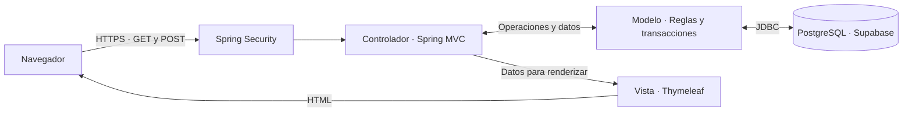

<p align="center">
  
</p>

# HiveOn

HiveOn es una aplicación web académica para gestionar apiarios, colmenas y la producción de miel. Permite conservar el historial sanitario, coordinar el trabajo de campo y consultar la trazabilidad de los lotes publicados.

[Abrir HiveOn](https://hiveon-ochre.vercel.app/) · [Guía de ejecución y pruebas](hiveon/README.md) · [Modelo de datos y migraciones](hiveon/supabase/README.md)

## 1. Problema y objetivo

Cuando las inspecciones, los tratamientos y las cosechas quedan dispersos entre registros, cuesta reconstruir qué ocurrió en una colmena o de dónde proviene un lote. HiveOn reúne esos datos alrededor de cada apiario y conserva la autoría y la fecha de las operaciones.

El sistema se desarrolló para la asignatura **Programación en Java – B193** de las **Unidades Tecnológicas de Santander**, a cargo de **Jerson Camilo Muñoz Gonzalez**. La revisión sanitaria es una simulación académica.

## 2. Roles y funciones

| Rol | Funciones principales |
| --- | --- |
| **Apicultor** | Registra y archiva sus apiarios y colmenas, vincula colaboradores, asigna tareas, registra inspecciones y cosechas, publica lotes, remite expedientes y consulta reportes. |
| **Operario** | Consulta los apiarios asignados, registra inspecciones y actualiza sus propias tareas. |
| **Técnico apícola** | Consulta los antecedentes de los apiarios que asesora y registra tratamientos y recomendaciones. |
| **Inspector sanitario simulado** | Revisa expedientes remitidos y registra una decisión de validación o rechazo por expediente. |
| **Comprador o acopiador** | Consulta lotes publicados, su origen registrado y las fechas de cosecha. |
| **Administrador** | Gestiona cuentas, roles y tipos de colmena, y consulta la auditoría. |

## 3. Metodología y sprints

El proyecto combina desarrollo guiado por especificaciones (SDD) con una adaptación individual de Scrum. Los requerimientos funcionales y no funcionales se vincularon con historias de usuario y escenarios de aceptación.

| Sprint | Incremento |
| --- | --- |
| **1 · Autenticación y apiarios** | Inicio y cierre de sesión, registro y consulta de apiarios propios, y selección de ubicación mediante DIVIPOLA. |
| **2 · Operación apícola** | Gestión de apiarios y colmenas, vinculaciones, inspecciones, tareas y seguimiento técnico. |
| **3 · Producción y revisión** | Cosechas, trazabilidad de lotes, expedientes sanitarios, reportes, administración y auditoría. |

## 4. Arquitectura MVC

HiveOn es un monolito en **Java 21 y Spring Boot** desplegado como contenedor en Vercel. **Spring MVC** recibe solicitudes GET y formularios POST. **Thymeleaf** renderiza el HTML en el servidor y **JDBC** conecta la aplicación con PostgreSQL.

| Componente | Responsabilidad |
| --- | --- |
| [Modelo](hiveon/src/main/java/com/hiveon/model) | Aplica reglas de negocio, comprueba el alcance por registro y ejecuta consultas parametrizadas y transacciones. |
| [Vista](hiveon/src/main/resources/templates) | Presenta formularios, listados y estados. Comparte el logotipo y una paleta de amarillo miel, verde salvia, crema, blanco y café. |
| [Controlador](hiveon/src/main/java/com/hiveon/controller) | Recibe solicitudes, valida los formularios, invoca el Modelo y selecciona una vista o una redirección. |



## 5. Base de datos

El esquema `hiveon` contiene **19 tablas**, incluidas las dos de Spring Session JDBC. El catálogo DIVIPOLA cargado contiene 33 códigos departamentales, incluido Bogotá D. C., y 1.103 municipios o distritos.

Las cosechas y los lotes se vinculan al apiario de origen. Las claves compuestas comprueban que la composición de un lote corresponda al mismo apiario. PostgreSQL también valida autores, vínculos vigentes, fechas y condiciones de publicación. [Consultar las migraciones SQL](hiveon/supabase/migrations).

## 6. Seguridad

- **Identidad y sesión.** El alta es administrada y cada cuenta tiene un rol. Las contraseñas se verifican con BCrypt. Spring Session JDBC conserva las sesiones del entorno desplegado.
- **Autorización.** Spring Security filtra las rutas por rol. El Modelo comprueba la propiedad, las asignaciones y el estado de los registros según la operación.
- **Protección de solicitudes y datos.** Los formularios POST requieren un token CSRF. El navegador se conecta por HTTPS y la conexión JDBC a Supabase se configura con TLS y verificación del servidor. Las credenciales de base de datos se toman de variables de entorno.
- **Auditoría.** El Administrador consulta los eventos registrados por la aplicación, con actor, acción, fecha y resultado.

## 7. Cómo ejecutar y verificar

Con Java 21 instalado, prepara una base PostgreSQL y aplica [las migraciones](hiveon/supabase/README.md). Desde la raíz del repositorio, abre PowerShell 7 y ejecuta:

```powershell
cd hiveon
$env:DB_URL = Read-Host 'URL JDBC de PostgreSQL'
$env:DB_USERNAME = Read-Host 'Usuario de PostgreSQL'
$env:DB_PASSWORD = Read-Host 'Contraseña de PostgreSQL' -MaskInput
.\mvnw.cmd spring-boot:run
```

Para ejecutar la suite completa, configura esas variables con una base de pruebas y ejecuta desde `hiveon`:

```powershell
.\mvnw.cmd -Psuite-completa verify
```

En Linux o macOS, usa `./mvnw`. La evaluación de MVC y del rediseño incluye **28 pruebas** unitarias, de controladores y de integración con PostgreSQL. El recorrido en Edge verificó la portada, el acceso, el inicio, Mis apiarios y Administración en escritorio y móvil. [Ver cobertura y preparación de la base de pruebas](hiveon/README.md#suite-de-pruebas).

## 8. Referencias

- Gestión del desarrollo por incrementos. [Guía Scrum de Ken Schwaber y Jeff Sutherland](https://scrumguides.org/scrum-guide.html).
- Desarrollo dirigido por especificaciones. [Documentación de GitHub Spec Kit](https://github.github.com/spec-kit/).
- Códigos territoriales de Colombia. [Catálogo DIVIPOLA del DANE](https://www.datos.gov.co/Mapas-Nacionales/DIVIPOLA-C-digos-municipios/gdxc-w37w).
- Controladores web y manejo de solicitudes. [Documentación de Spring MVC](https://docs.spring.io/spring-framework/reference/web/webmvc.html).
- Autenticación, autorización y protección de formularios. [Documentación de Spring Security](https://docs.spring.io/spring-security/reference/servlet/index.html).
- PostgreSQL administrado y configuración de conexiones. [Documentación de Supabase Database](https://supabase.com/docs/guides/database/overview).
